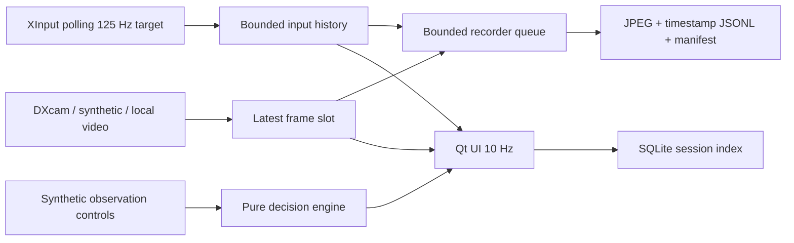

# Architecture

## Phase 1 implementation

`windows.py`: ctypes bindings with pointer-width-safe signatures, XInput reconnection across four user slots, visible window title enumeration, foreground check, client rectangle coordinates and DPI awareness. Dashboard uses raw normalized axes; XInput does not expose the Xbox Guide button. Wired/wireless support depends on the controller being exposed by Windows XInput. Only one active slot is monitored.

`runtime.py`: independent input and capture threads, immutable snapshots and locked bounded input history; no growing frame pipeline. DXcam is created, grabbed and released by the capture thread. Capture is limited to a matching foreground window's client rectangle. Multi-monitor origins and adapter/output indices are configurable; cross-monitor windows are rejected. Images are reduced to a preset width after acquisition. Stale previews are cleared. A recording worker handles encoding/storage. UI refresh runs at 10 Hz and metrics at 1 Hz; GPU detection runs once off the GUI thread.

`recording.py`: bounded eight-frame queue; drop-new policy keeps accepted ordering and logs a count. Writes JPEG then JSONL with flush, final manifest marks clean closure or an error. The initial manifest is incomplete so abrupt termination is distinguishable. Disk space threshold is 256 MiB. Errors stop the writer and are visible in the UI. This format favors explicit timing over fixed-FPS video; it can use substantial storage. Frames are immutable after publication. Controller timestamps are acquisition-completion times, not game-consumption times.

`decisions.py` and `models.py`: pure simulation only, with bounded outputs, speed-dependent braking and confidence/focus/staleness/manual-override gates. There is no virtual output adapter. No actual steering, trail braking, grip estimation or crash recognition is claimed.

`config.py`: validated settings with atomic replacement. Data defaults outside the checkout and can be redirected. `database.py`: SQLite version 1 stores sessions and reserves a versioned profile table; profile generation/import/export are not implemented. `system.py`: Windows CIM GPU enumeration and process metrics. `hotkeys.py`: documented RegisterHotKey with registration-conflict reporting and cleanup. UI controls do not overlay the game.

## Boundaries for later phases

Add independent `vision` (frame → confidence-bearing observations), `hud` (calibrated normalized ROIs), `track_recognition` (landmarks → uncertain progression), `learning` (multiple reference laps → versioned candidate profile), and `inference` (optional ONNX provider) packages when implementing those phases. They are design boundaries, not empty implementations today. Braking, steering and throttle controllers should become separate calibrated components before hardware output is allowed.

A future circuit profile payload must include layout representation, reference landmarks, corners (direction/curvature), target speed and braking/acceleration zones, normalized racing-line points, reference lap IDs, best valid lap time, category/model/weather, confidence and schema version. Profiles must distinguish estimated image coordinates from world coordinates. Never manufacture circuit data to fill these fields.

No official MotoGP 26 telemetry interface has been verified. Initial integration therefore uses screen capture. Game focus does not prove active racing: menus, replays, loading screens and pauses can be recorded in Phase 1. Gameplay-state recognition is a prerequisite to any future live assistance. Physical and virtual devices are not combined now, so duplicate-input handling is unnecessary until a supported output backend is selected.

## Performance strategy

Preset targets: Lightweight 30 FPS / width ≤960, Balanced 60 / ≤1280, Performance 120 / ≤1920. Preserve aspect ratio and do not upscale. Targets do not assert these rates on either user's PC. Current adaptation reduces the rate on local capture/resize overruns, with a floor of 10 FPS; no direct OBS or GPU-load arbitration exists yet. Prioritize the laptop, one fixed third-person camera, 1080p first. JPEG work is on a bounded worker; high-resolution capture can still compete with OBS. Measure before adding models, zero-copy sharing or GPU inference.
