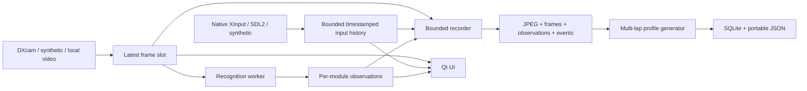

# Architecture — version 0.2

## Execution and ownership

`controllers.py` owns native DLL routes and SDL handles on the controller thread. `ControllerManager` enumerates, selects, retries and reports devices without blocking capture. `controller_test.py` is independent of Qt/capture/OCR. `windows.py` now contains shared fixed-width XInput data structures plus documented window/DPI APIs; the old polling implementation was removed.

`runtime.py` runs input (~125 Hz target), capture (preset target) and recognition (2 Hz default) independently. Latest-frame replacement prevents analysis backlog. Capture requires a matching foreground window. Controller input continues in the background. A retained last frame permits calibration after switching focus. Shared snapshots are published under a lock; controller reconfiguration and analysis calibration are handed to the owning worker. Capture/recording remain usable when recognition fails.

`vision.py` uses CPU-only bundled RapidOCR/ONNX sessions (two intra-op threads, one inter-op thread) and OpenCV capped at two threads. OCR reads labelled HUD candidates, calibrated single-line crops and state text. Parsing enforces gear/speed/timer/lap ranges. Small/unlabelled/ambiguous/low-confidence text is unknown. Calibration is normalized, not hard-coded to game coordinates.

Road segmentation compares Lab appearance against a manually selected asphalt patch, limits search to a calibrated region and follows a connected component. Image-space boundaries and perspective centreline bend produce approximate corner direction; bike offset uses an explicitly calibrated fixed-camera anchor. HSV blobs inside the road corridor are candidate green/yellow/red ideal-line sections. The minimap module extracts a bright outline and colored marker in a calibrated ROI. ORB features plus perceptual image hashes form visual references. No world coordinates, true lean angle, grip, optimal line or hidden physics are inferred.

State recognition requires visible text for pause/loading/crash/recovery and two consecutive observations. Visible speed plus road evidence can suggest gameplay but cannot distinguish every replay/menu. Unlabelled crashes return unknown. Confidence values are OCR scores and heuristics, not statistically calibrated accuracy.

`calibration.py` supplies a drag-to-select editor with correct letterbox-to-normalized-coordinate conversion. `phase2_ui.py` adds recognition/diagnostics and profile workflows while preserving dashboard, simulation, settings and tray. Long video/profile jobs run off the GUI thread; cancellation preserves incomplete session evidence.

## Recording and learning

`recording.py` writes JPEG frames and per-frame raw controller samples through a bounded eight-frame queue. A separate bounded 128-observation queue preserves the matching sequence/timestamp, input sample and provenance for each analyzed frame. Observations can exist for a frame whose image was dropped; join on sequence against frames.jsonl before opening images. No invented temporal alignment is added. Manual lap-boundary events finalize into events.jsonl. The initial manifest is incomplete; final complete/error/drop counts distinguish graceful closure from failure. Physical inputs older than 100 ms are invalid. These are acquisition-completion times, not game-consumption or hardware synchronization timestamps.

`analyze_video.py` decodes a prerecorded file sequentially, analyzes selected frames and writes media time (frame index/FPS). Original controller input is unavailable. Offline analysis avoids live backlog/drop constraints and does not overwrite an existing destination. The GUI indexes completed output as a reference session; a CLI is also provided.

`learning.py` segments explicit lap markers, or confirmed consecutive OCR lap-number transitions. At least two complete laps with adequate speed evidence are required. Each lap is aligned by normalized elapsed time; speed bins aggregate medians and track coverage/sample support. Perspective bend changes yield corner entry/exit estimates. Colored-line observations form visual braking intervals. Landmarks/line sections retain lap and frame references. Category/model/weather labels must match; different provenance (synthetic/video/Windows) cannot mix. No control policy or global track localization is trained.

`database.py` stores profiles and session history using parameterized SQL and validated finite JSON. Import/export is versioned and size-limited (20 MiB), rejects malformed profiles and duplicate IDs, and never unpickles or loads referenced paths. Delete removes only the selected profile; recordings remain. Exported profiles embed extracted reference data but not images; copy full sessions separately.

## Boundaries and performance

Live riding output remains absent. `decisions.py` continues to exercise synthetic bounded decisions and safety gates. A maintained, permitted virtual output and physical-device isolation path remains a prerequisite to actual intervention.

Capture targets remain 30/60/120 FPS at widths ≤960/1280/1920. Recognition target is independent and may run below 2 Hz on hardware. Capture overruns reduce its target; direct game/OBS GPU contention detection is not implemented. CPU inference avoids allocating game GPU resources by default. Cropped HUD readability must be checked at the selected capture resolution. Profiles and calibration are camera/layout/conditions specific.
